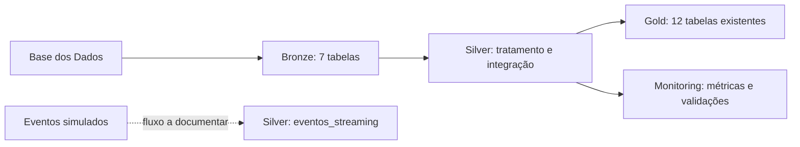

# Alfabetização no Brasil — Tech Challenge de Engenharia de Dados

Link do repositório no GitHub: https://github.com/slubasanderson-bit/tech-challenge-alfabetizacao

Link do vídeo de apresentação: https://drive.google.com/file/d/1WYbIam_rOKye83_kjI6RDXYGot_-zwes/view

Este repositório reúne a parte do Tech Challenge que desenvolvi usando o Google Cloud, principalmente o BigQuery. O objetivo foi organizar dados públicos sobre alfabetização, tratar as informações e produzir tabelas que permitam acompanhar resultados por município, estado e Brasil, inclusive em comparação com as metas educacionais.

Optei por uma estrutura relativamente simples: os dados ficam nas camadas Bronze, Silver e Gold, e as verificações são registradas à parte. Assim, consigo explicar de onde os números vieram e repetir as consultas principais sem depender de uma infraestrutura grande.

> Situação da entrega (03/11/2026): O projeto foi implementado no Google Cloud, utilizando as camadas Bronze, Silver, Gold e Monitoring. Ao todo, foram identificadas 12 tabelas na Gold.

Também consegui recuperar os scripts SQL utilizados em diferentes etapas do desenvolvimento, incluindo a carga inicial dos dados, transformações, indicadores, verificações de qualidade, streaming e monitoramento.

Esses códigos foram organizados na pasta sql, e o histórico das execuções recuperadas está documentado em docs/indice_jobs_recuperados.csv.

Ainda existem algumas limitações: o código original responsável pela geração dos eventos simulados não foi recuperado, algumas tabelas são substituídas durante a execução e a pipeline completa ainda não está automatizada para reprodução do zero. Essas questões estão detalhadas na documentação técnica.

## 1. Dados e objetivo

A fonte é a [Base dos Dados — `br_inep_avaliacao_alfabetizacao`](https://basedosdados.org/dataset/073a39d4-89cf-4068-b1e8-34ed0d9c0b72?table=e1de7a6a-5038-4e81-89f0-a15f2cc12c9b). Foram trabalhadas as entidades `alunos`, `municipio`, `uf`, `meta_alfabetizacao_municipio`, `meta_alfabetizacao_uf`, `meta_alfabetizacao_brasil` e o `dicionario` de códigos.

O ponto de partida foi uma dificuldade comum nesse tipo de base: nem sempre um indicador calculado diretamente dos microdados pode ser comparado a uma meta publicada. É preciso conferir o peso amostral, a rede de ensino, a série e o período. Por isso, mantive separados os cálculos feitos com os registros dos alunos e as comparações que usam os indicadores publicados na própria fonte.

A meta pactuada de alfabetização para a rede pública em 2030 é de **80%**, conforme a tabela de metas utilizada. Ela é diferente da aspiração mais ampla de universalização da alfabetização.

## 2. Como organizei a solução



- **Bronze:** dados carregados da fonte. Foram identificadas sete tabelas. Ainda falta comprovar a política de preservação das versões anteriores em novas cargas.
- **Silver:** limpeza, classificação de presença/alfabetização e enriquecimento com descrições de códigos. Foram identificadas nove tabelas, incluindo `alunos_enriquecidos` e `eventos_streaming`.
- **Gold:** foram encontradas 12 tabelas no console. Sete possuem scripts reunidos neste repositório; as outras cinco são de uma etapa anterior e estão listadas na seção seguinte.
- **Monitoring:** foram identificadas sete tabelas relacionadas a métricas, qualidade, streaming e custos. A existência dessas tabelas não comprova, sozinha, alerta automático ou histórico acumulado de todas as execuções.

Escolhi usar o BigQuery diretamente porque a fonte já está disponível nesse ambiente e as transformações podem ser feitas em SQL. Isso reduz a necessidade de mover arquivos entre serviços. A contrapartida é acompanhar o volume processado pelas consultas e evitar reexecutar cargas sem necessidade. Atualizações automáticas da fonte não estão configuradas neste pacote.

Detalhes: [arquitetura e decisões](docs/arquitetura.md).

## 3. O que encontrei na Gold

| Tabela | Para que serve |
|---|---|
| `indicadores_alfabetizacao_municipio` | Contagens e taxa **simples** por município e ano |
| `indicadores_alfabetizacao_brasil` | Agregação simples dos microdados; **não é** o indicador nacional oficial |
| `indicadores_alfabetizacao_uf` | Agregação simples por código de UF |
| `indicadores_alfabetizacao_municipio_ponderado` | Taxa calculada com o peso amostral, separando rede e série |
| `comparacao_metas_municipais` | Resultado municipal publicado comparado à meta municipal de 2024 |
| `comparacao_metas_estaduais` | Resultado da rede pública (código `5` na tabela `uf`) comparado à meta estadual |
| `comparacao_metas_brasil` | Resultado nacional publicado comparado à meta nacional de 2024 |

Além dessas sete tabelas, a captura do BigQuery mostra outras cinco já existentes: `desempenho_municipal`, `indicadores_brasil`, `indicadores_municipio`, `indicadores_streaming` e `indicadores_uf`. Seus nomes e sua existência foram conferidos no console, mas os scripts de criação não estão reunidos neste repositório. Por isso, não atribuo resultados não verificados a essas tabelas.

As tabelas de comparação utilizam o indicador publicado na fonte. Já as tabelas calculadas a partir dos microdados são identificadas como cálculos próprios. Fiz essa separação para não tratar indicadores com universos potencialmente diferentes como se fossem o mesmo número.

O dicionário oficial confirmou, nas tabelas territoriais, `3 = Municipal` e `5 = Pública (Estadual e Municipal)`. A tabela de metas usa a descrição textual da rede; os relacionamentos foram feitos respeitando essas diferenças. O recorte utilizado nas comparações foi 2024, 2º ano do Ensino Fundamental quando a tabela de resultado possui série.

## 4. Algumas verificações e resultados

As consultas de conferência executadas no BigQuery retornaram:

| Medida calculada com microdados | 2023 | 2024 |
|---|---:|---:|
| Registros | 1.747.439 | 2.120.560 |
| Avaliados | 1.502.809 | 1.851.852 |
| Taxa simples | 58,39% | 59,78% |
| Taxa ponderada pelo peso do aluno | 57,46% | 59,20% |

A taxa ponderada considera somente os alunos efetivamente avaliados: soma dos pesos dos alfabetizados dividida pela soma dos pesos de todos os avaliados. Alunos ausentes ou sem caderno não entram nesse denominador.

Na comparação municipal de 2024, encontrei **5.448** resultados, dos quais **5.352** tinham correspondência na base de metas (**98,24%**). Entre as **5.232** comparações com meta preenchida, **2.788** atingiram a meta e **2.444** ficaram abaixo dela. Outras **120** tinham meta sem valor e **96** não tinham cadastro correspondente. Essas situações foram preservadas separadamente.

A tabela nacional de metas informa, para a rede pública em 2024, resultado de **59,2%** e meta pactuada de **59,9%** (diferença de **-0,7 ponto percentual**). Mesmo sendo igual ao valor ponderado arredondado dos microdados, isso não prova que os dois cálculos tenham a mesma cobertura.

A base processada de alunos abrangeu **23 UFs em 2023 e 26 em 2024**. Em 2023 não apareceram AC, DF, RR e SP; em 2024, RR. As ausências já foram verificadas na Bronze, mas não consegui estabelecer se surgiram na fonte ou na ingestão. Por isso, não considero as taxas calculadas com esses microdados uma estimativa nacional oficial.

Os números principais também estão em [arquivos_de_apoio](arquivos_de_apoio/). Eles foram transcritos dos resultados compartilhados na execução, e não extraídos automaticamente por este repositório.

## 5. Validações e processamento híbrido

Na Silver, a classificação diferencia alfabetizados, não alfabetizados, ausentes, estudantes sem caderno e registros a revisar. Na criação das comparações Gold, incluí verificações `ASSERT` antes da publicação. Elas conferem duplicidade de chaves e, na comparação municipal, impedem a criação se a taxa de correspondência ficar abaixo de **95%**.

Esse limite foi escolhido como uma regra operacional para aceitar pequenas faltas de cadastro sem liberar um relacionamento muito incompleto. Na execução de 2024, a taxa foi 98,24%. As consultas com `ASSERT` e a criação das tabelas foram concluídas com sucesso; um **teste que provoque falha** precisa ser anexado como evidência se disponível.

Também houve teste de eventos simulados, relatado anteriormente como **5 eventos recebidos, 3 processados, 1 duplicado e 1 inválido**. A tabela `silver.eventos_streaming` foi identificada no console, mas o código de mensageria/recepção, o cálculo de latência e a publicação final desses eventos na Gold não fazem parte deste pacote. Portanto, não trato o caminho de streaming ponta a ponta como comprovado pelo repositório.

## 6. Como executar o que está neste pacote

Pré-requisitos: Python 3, Google Cloud SDK (`bq`), acesso autenticado ao projeto GCP e **tabelas Silver já existentes**, com esquema compatível com os SQLs.

```bash
# Faça login com a conta que tem permissão no projeto
gcloud auth login

# Recria as sete tabelas Gold em sequência
python scripts/run_gold.py --project SEU_PROJETO_GCP --location US

# Opcional: executa somente a quinta etapa
python scripts/run_gold.py --project SEU_PROJETO_GCP --location US --only 5
```

O script `scripts/run_gold.py` foi preparado para chamar `bq query` lendo os arquivos SQL na ordem correta. Ele foi conferido localmente, mas **não foi executado contra o GCP nesta revisão**. Para executar manualmente, substitua `__PROJECT_ID__` no SQL pelo ID do seu projeto.

Os scripts da Gold usam `CREATE OR REPLACE TABLE`: executar novamente **substitui o conteúdo anterior**. Não recomendo reexecutá-los sem motivo. O script Silver disponível é apenas uma parte do tratamento e também não deve ser usado indiscriminadamente para reconstruir a camada.

O repositório não contém credenciais. Chaves, tokens e arquivos de autenticação devem ficar fora do GitHub.

## 7. Custos, limites e próximos usos

Medições anteriores indicaram aproximadamente **1,53 GiB de armazenamento lógico** e consultas processando de KB a MB. Esses valores não são, por si só, uma fatura. Falta consolidar quantidade mensal, preço unitário e a projeção de custo de produção. Registrei os dados disponíveis e a forma de completar o cálculo em [FinOps](docs/finops.md).

A Gold pode servir de base para análises regionais e, numa próxima fase, modelos preditivos. Nessa aplicação, seria importante controlar diferenças de cobertura e evitar usar a própria taxa de alfabetização (ou algo derivado dela) para prever essa mesma taxa.

**Limitações principais:** ausência do código completo das cargas Bronze, de partes da Silver, do fluxo de streaming e da implementação integral de monitoramento/alertas; histórico das cargas Bronze e reprodutibilidade total ainda não demonstrados. As seis capturas principais já foram reunidas na pasta `evidencias/`; ainda falta conferir se há uma captura separada da falha bloqueante e completar os códigos anteriores que não foram recuperados. A lista objetiva do que resta está em [pendências de entrega](docs/pendencias.md).

## 8. Materiais da entrega

Registrei no GitHub seis capturas feitas no ambiente usado no projeto. Elas servem como evidências da estrutura e das execuções observadas; não substituem os scripts de partes da pipeline que ainda não foram recuperados.

| Evidência | Conteúdo |
|---|---|
| [01 — Camadas no BigQuery](evidencias/01_camadas_bigquery.png) | Datasets Bronze, Silver, Gold e Monitoring |
| [02 — Tabelas Gold](evidencias/02_tabelas_gold.png) | 12 tabelas visíveis no console |
| [03 — Validações de qualidade](evidencias/03_validacoes_qualidade.png) | Execução de `ASSERT` com sucesso; não demonstra falha bloqueante |
| [04 — Streaming](evidencias/04_streaming.png) | Métricas registradas do teste de eventos simulados |
| [05 — Monitoramento](evidencias/05_monitoramento.png) | Captura do acompanhamento da pipeline |
| [06 — FinOps](evidencias/06_finops.png) | Captura das medições de custo e consumo |

- [Arquitetura e linhagem](docs/arquitetura.md)
- [FinOps](docs/finops.md)
- [Notas sobre as evidências](evidencias/LEIA-ME.md)
- [Roteiro do vídeo executivo](docs/roteiro_video.md)
- **Vídeo executivo:** adicionar o link da gravação antes da entrega.

O foco deste repositório é mostrar o que consegui construir, o que os resultados indicam e quais pontos ainda exigem atenção — sem apresentar como implementado algo que não foi comprovado.
