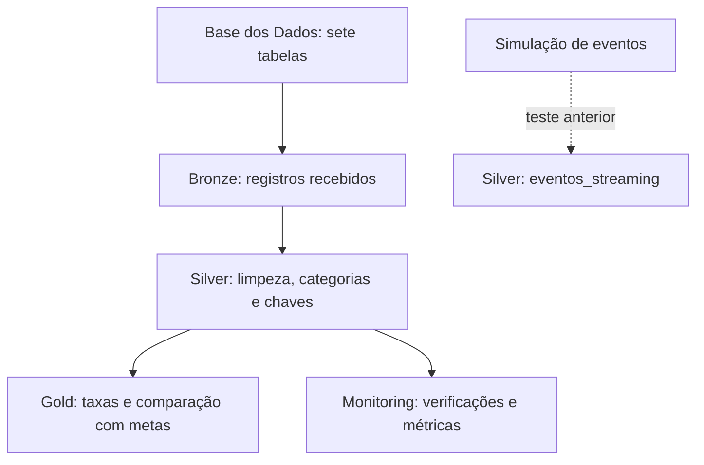

# Arquitetura e decisões do projeto

## Por que BigQuery?

A Base dos Dados disponibiliza as tabelas no BigQuery. Preferi trabalhar ali porque a maior parte do desafio podia ser resolvida com SQL: ingestão histórica, tratamento, integração, agrupamentos e validações. Isso tornou o projeto mais viável dentro do escopo acadêmico e evitou transferências de arquivos entre provedores. A escolha também exige atenção aos bytes processados e às permissões na nuvem.

## Fluxo observado

**Bronze:** sete tabelas confirmadas no console. Não foi recuperado o código de carga original nem comprovado o comportamento de escrita em reexecuções; por isso, não afirmo que cada carga preserve historicamente a anterior.

**Silver:** nove tabelas identificadas. A classificação dos estudantes é feita com `presenca`, `preenchimento_caderno` e `alfabetizado`. A `alunos_enriquecidos` possui os textos de rede/série obtidos do dicionário e o campo `peso_aluno` usado na taxa ponderada.

**Gold:** sete tabelas criadas no BigQuery, com scripts versionados neste pacote. Três são agregações simples de microdados, uma é ponderada por aluno e três comparam resultados publicados com metas.

**Monitoring:** sete tabelas identificadas (`finops_projeto`, `metricas_pipeline`, `metricas_streaming`, `resultados_qualidade`, `teste_falha_qualidade`, `validacao_dicionario` e `validacao_integracao_municipal`). O código que as alimenta e a configuração de notificação ainda não foram anexados.

**Streaming:** houve teste com eventos simulados e foi identificada `silver.eventos_streaming`. O material disponível não permite demonstrar toda a cadeia até a Gold ou medir a latência de modo reproduzível. O fluxo acima mostra somente o que foi possível localizar.

## Duas formas de olhar o indicador

1. **Microdados:** os valores simples e ponderados foram calculados a partir de alunos avaliados. O peso amostral altera o resultado, e a cobertura geográfica da base processada é incompleta em alguns anos.
2. **Resultados publicados:** as comparações municipais, estaduais e nacionais usam `taxa_alfabetizacao` da fonte, relacionada às metas correspondentes. Na tabela `uf`, o código `5` significa "Pública (Estadual e Municipal)"; no registro da meta a rede aparece como "Pública".

Não utilizei média simples de taxas municipais para obter uma taxa nacional oficial. Também mantive meta nula e resultado nulo como situações diferentes de "meta não atingida".

## Qualidade antes de publicar

Os scripts `sql/gold/05_*` a `07_*` contêm `ASSERT` para evitar publicar dados com chave duplicada. A comparação municipal inclui uma regra de correspondência mínima de 95%. Os testes apresentados no BigQuery passaram; para demonstrar o comportamento em caso de erro, é preciso anexar uma execução de falha real.

Os comandos `CREATE OR REPLACE` da Gold recriam snapshots analíticos. **Essa estratégia não substitui uma política de histórico da Bronze.**
